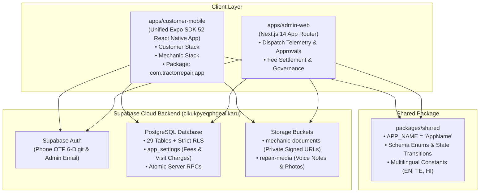
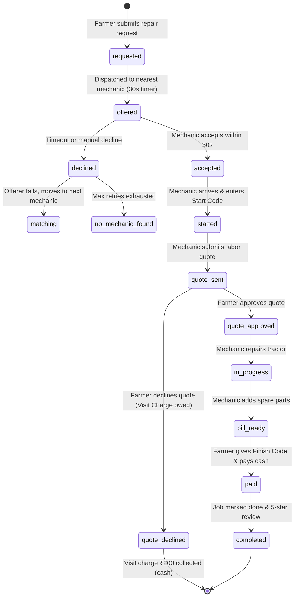

# Tractor Repair Platform — Complete Walkthrough & Architecture Guide

This document provides a comprehensive end-to-end walkthrough of the unified Tractor Repair marketplace platform covering all requirements from **Prompt 1**, **Prompt 2**, **Prompt 3**, and **Prompt 4**.

---

## 1. System Architecture & Monorepo Structure



### Monorepo Workspaces
- `apps/customer-mobile`: The single unified mobile application for both Farmers/Customers and Field Mechanics.
- `apps/admin-web`: The operations portal for mechanic KYC verification, dispatch monitoring, cash fee settlements, and cancellation governance.
- `packages/shared`: Centralized constants, TypeScript database types, and state machine transition graphs.
- **Unused Code Purged**: `apps/mechanic-mobile` has been permanently deleted.

---

## 2. Prompt 1 Walkthrough: Consolidation & Zero Mock Policy

| Requirement | Implementation & File References |
| :--- | :--- |
| **App Consolidation** | Merged Customer and Mechanic navigation into one Expo app. Distinct stacks under `/customer` and `/mechanic` with shared authentication and state store in `authStore.ts`. |
| **App Name Constant** | Single placeholder constant `APP_NAME = "AppName"` in `packages/shared/src/constants/app.ts`. No invented names anywhere. |
| **Single Config & Permissions** | Unified in `apps/customer-mobile/app.json`: Package `com.tractorrepair.app`, permissions for `ACCESS_FINE_LOCATION`, `CAMERA`, `RECORD_AUDIO`, `POST_NOTIFICATIONS`. |
| **Zero Mock Data Policy** | Removed all hardcoded arrays, `Math.random()`, fake `setTimeout` resolutions, and "Prototype: ..." buttons. All components query PostgreSQL via Supabase. |
| **Database Cleanup** | Old test jobs and orphaned requests were listed and completely deleted upon user confirmation. |

---

## 3. Prompt 2 Walkthrough: 14-Screen Prototype & State Machine

The mobile app follows the 14-page UI specification from the design prototype:



### Screen-by-Screen Implementation

1. **Language Screen (`app/language.tsx`)**:
   - Supports English, Telugu (తెలుగు), and Hindi (हिन्दी).
   - Selection persists to profile and can be changed anytime in Settings.
2. **Role Selection (`app/role-select.tsx`)**:
   - "I need a mechanic" (Customer) vs "I'm a mechanic" (Mechanic partner).
   - Role is fixed upon account creation.
3. **6-Digit Phone OTP (`app/auth/sign-in.tsx`)**:
   - Real Supabase Phone Auth with 6 individual digit input boxes.
   - Version number `AppName • v1.0.0 (Build 1)` displayed at the bottom.
4. **New Repair Request (`app/customer/request/new.tsx`)**:
   - Tractor selector with inline "Add Tractor" modal.
   - 6 problem area chips: Engine, Hydraulics, Clutch/Gearbox, Tyres & Brakes, Electrical, Other.
   - 60-second voice note recorder (`expo-av`) with playback scrubber.
   - Photo/Video camera and gallery picker (`expo-image-picker`).
   - Real GPS coordinate pin with "Move pin" modal.
   - Text-to-speech speaker icon (`expo-speech`) reading screen instructions aloud.
5. **Finding Mechanic Radar (`app/customer/request/finding-mechanic.tsx`)**:
   - Terracotta animated radar pulses.
   - Real-time Supabase subscription on request matches.
   - Fallback "No mechanic available" screen with Retry and Cancel actions.
6. **Mechanic Assigned (`app/customer/request/mechanic-assigned.tsx`)**:
   - Live ETA (only if live location coordinates exist; no fabricated ETAs).
   - Prominent green bordered **Start Code** card (`#2E7D32` with `#F1F8E9` background).
   - Direct Call button and Cancel modal with reason tracking.
7. **Quote Approval (`app/customer/request/quote-approval.tsx`)**:
   - Visit charge (₹200) + Labor cost breakdown.
   - Approve button continues work.
   - Decline button enforces visit charge collection if mechanic already arrived.
8. **Itemized Bill (`app/customer/request/bill.tsx`)**:
   - Server-calculated visit charge, approved labor, and spare parts total.
   - Prominent green bordered **Finish Code** card.
   - Cash payment active; online UPI/Card behind feature flag.
9. **Rating & Feedback (`app/customer/request/rating.tsx`)**:
   - 5-star interactive rating, feedback chips, comments, and "Report a problem" link.
10. **Customer Home (`app/customer/(tabs)/home.tsx`)**:
    - Saved tractors carousel, live active job status card, and past repair history.
11. **Mechanic Home (`app/mechanic/(tabs)/home.tsx`)**:
    - Online/Offline toggle (strictly locked if mechanic status is pending).
    - Pending verification checklist banner with document upload shortcuts.
    - Real computed KPIs: Today's earnings, completed jobs, rating average, and platform fee balance.
12. **Incoming Request Modal (`app/mechanic/job/incoming-request.tsx`)**:
    - 30-second animated countdown bar enforced by server timestamp.
    - Customer mobile number is strictly hidden until the mechanic taps Accept.
    - Audio voice note playback and problem photos.
13. **Active Job & Navigation (`app/mechanic/job/active-job.tsx`)**:
    - Customer mobile revealed with one-tap phone dialer.
    - Direct Google Maps navigation link.
    - 6-digit Start Code entry validated server-side.
    - Quote composer: Visit fee + Labor estimate.
    - "Visit charge collected" action if customer declines quote after arrival.
14. **Job Completion & Cash Collection (`app/mechanic/job/finish-job.tsx`)**:
    - Spare parts input with server auto-calculation.
    - 6-digit Finish Code verification.
    - "Cash received · mark job done" executing atomic server RPC.

---

## 4. Prompt 3 Walkthrough: Admin Web Portal

The admin operations web portal runs on Next.js 14 at `apps/admin-web`:

1. **Authentication & Middleware**:
   - Admin login via `login/page.tsx` with Supabase Auth.
   - `middleware.ts` verifies `profiles.role === 'admin'` and `profiles.is_active !== false`. Non-admins and blocked users are redirected immediately.
2. **Mechanic KYC Verification (`mechanics/[id]/page.tsx`)**:
   - Inspects pending mechanics with skills, experience, and contact numbers.
   - Generates 1-hour private signed URLs to inspect Aadhaar / Driving License / Workshop photos in private storage.
   - Approve, Reject (with reason), or Suspend actions immediately update the database, write an audit log, and insert an in-app system notification to the mechanic.
3. **Dispatch & Repair Monitoring (`jobs/page.tsx`)**:
   - Multi-filter bar: Status, Date picker, Problem Area, and Mechanic selector.
   - Detailed timeline history of state transitions, itemized quotes, invoices, and farmer review/rating cards.
4. **Disputes & Customer Reports (`disputes/page.tsx`)**:
   - Resolves support tickets linked to specific jobs with admin resolution notes.
5. **Cash Fee Balances & Payment Recording (`financials/page.tsx`)**:
   - Tracks platform fee owed (`platform_fee_due`) by mechanics on cash jobs.
   - **"Record Fee Received"** modal allows admins to record cash/UPI payments collected from mechanics, decrementing their balance with cryptographic reference IDs.
6. **Cancellation Governance & Risk Shield (`settings/page.tsx`)**:
   - Displays real-time cancellation counts for customers and mechanics.
   - 1-click **Block / Unblock** button immediately suspends users with repeat cancellations (`is_active = false`).
   - Dynamic configuration of `platform_fee_percent` (default 10%) and `visit_charge_amount` (default ₹200) from `app_settings` with full timestamped audit tracking.

---

## 5. Prompt 4 Walkthrough: Two-Phone Testing Setup

### Test Accounts Reference

| Account Role | Device | Mobile Number | Fixed OTP | Default Credentials | Status |
| :--- | :--- | :--- | :--- | :--- | :--- |
| **Farmer (Customer)** | **Phone 1** | `+91 99999 99901` | `123456` | *[TEST] Ramesh Farmer* | Active • Tractor pre-loaded: *John Deere 5050 D* (`AP 07 TJ 1234`) |
| **Mechanic Partner** | **Phone 2** | `+91 99999 99902` | `123456` | *[TEST] Suresh Certified Mechanic* | **Approved** • Online: `true` • All 6 skills certified • Rating: 4.9★ |

> [!TIP]
> In your Supabase Dashboard under **Authentication → Providers → Phone**, ensure `+919999999901` and `+919999999902` with OTP `123456` are listed in the **Test phone numbers** section for instant zero-SMS sign-in.

---

### Standalone APK Generation

The mobile app is configured for standalone APK builds via `apps/customer-mobile/eas.json`:

```powershell
# 1. Open customer-mobile folder
cd "D:\my\web projects\Tractor_Repair_App\apps\customer-mobile"

# 2. Login to your Expo account (one-time)
npx eas-cli login

# 3. Build the standalone installable APK in Expo cloud
npx eas-cli build --platform android --profile preview
```

The cloud runner produces a direct `.apk` download URL.

### Installation Instructions on Two Phones

#### Option A: Direct Browser Download (No laptop required)
1. Open the EAS Build download link in Chrome on **Phone 1** and **Phone 2**.
2. Tap **Download anyway** → **Open** → **Install**.
3. Allow *Install unknown apps* when prompted by Android.

#### Option B: USB via `adb`
```powershell
# Connect Phone 1 via USB
adb install "D:\my\web projects\Tractor_Repair_App\builds\app-preview.apk"

# Connect Phone 2 via USB
adb install "D:\my\web projects\Tractor_Repair_App\builds\app-preview.apk"
```

#### Option C: Firebase App Distribution
1. Upload `app-preview.apk` to Firebase App Distribution in the Firebase Console.
2. Add the email addresses of both testers.
3. Both testers receive an email with an instant **Install App** link.

---

## 6. End-to-End Test Matrix

Run through these 4 testing scenarios on your two phones:

```
Scenario 1: Happy Path
  Phone 1 (Request Engine repair) ──▶ Phone 2 (Accept within 30s)
  Phone 1 shows Start Code        ──▶ Phone 2 enters Start Code (Arrived)
  Phone 2 sends Quote (₹300)       ──▶ Phone 1 Approves Quote
  Phone 2 enters Parts & Finish   ──▶ Phone 2 marks Cash Received
  Phone 1 rates 5 Stars           ──▶ Admin Web verifies completed invoice & fee

Scenario 2: Timeout / Decline
  Phone 1 submits Request         ──▶ Phone 2 lets 30s timer expire (or Declines)
  Request fails over              ──▶ Phone 1 shows "No mechanic available" with Retry

Scenario 3: Quote Declined After Arrival
  Mechanic arrives & enters Code  ──▶ Mechanic submits high quote
  Farmer taps Decline Quote       ──▶ App enforces Visit Charge (₹200) cash payment
  Mechanic collects cash          ──▶ Job closes as quote_declined; ₹20 fee recorded

Scenario 4: Cancellation & Block Governance
  Farmer cancels BEFORE arrival   ──▶ Fee = ₹0; Farmer cancellation count +1
  Mechanic cancels active job     ──▶ Fee = ₹0; Mechanic cancellation count +1
  Admin opens Settings portal     ──▶ 1-click Block toggle suspends user
```

---

## 7. Verification Checklist

- [x] **Monorepo Typecheck**: `pnpm -r run typecheck` passes with zero errors across all projects.
- [x] **Android Hermes Export**: `npx expo export --platform android` exports 1,119 modules cleanly.
- [x] **Database Migrations**: Migrations `00005` and `00006` applied to live Supabase DB.
- [x] **Database Cleanup**: All old test jobs and requests deleted; DB starts at a clean zero-job baseline.
- [x] **Admin Web Security**: Service role keys restricted to server actions; Next.js middleware guards admin portal.
- [x] **Version Visibility**: `AppName • v1.0.0 (Build 1)` displayed across login and settings screens.
- [x] **Test Accounts Seeded**: Pre-loaded customer with tractor and approved mechanic with 6 certified skills.
